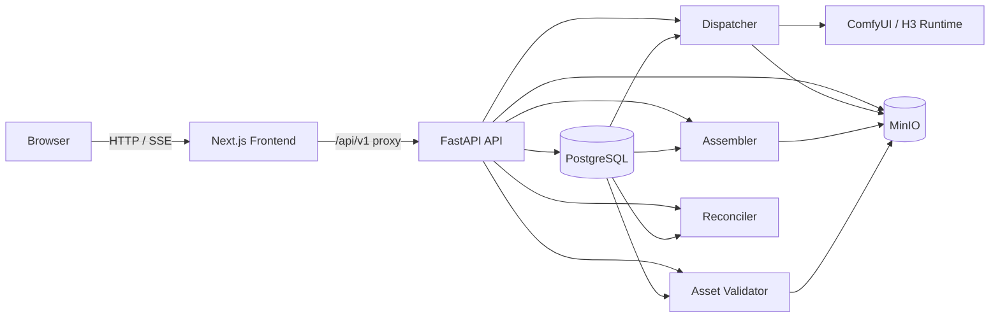

<div align="center">

# 🎬 AI Video Studio

### On-premise AI advertising video production, from scene planning to final assembly

Build, generate, review, select, and assemble AI video campaigns through a single web studio backed by production-oriented generation workers and durable asset storage.

[](./frontend)
[](./frontend)
[](./backend)
[](./backend)
[](./infra/compose.yaml)
[](./infra/compose.yaml)

**Frontend** · **API** · **Generation workers** · **H3 Director** · **Assembly** · **SSE live updates** · **MinIO assets**

</div>

---

## ✨ What this project does

AI Video Studio is a monorepo for an on-premise advertising-video workflow. It keeps the creative UI, generation orchestration, worker execution, asset lifecycle, and final-video assembly in one system while keeping the frontend and backend as separate applications.

| Capability | What it provides |
| --- | --- |
| 🎞️ Scene-based production | Build a video from ordered scenes with per-scene prompts and generation settings. |
| 🧠 AI generation workflows | Original generation, regenerate/variation flows, Generate All, and Director-driven execution. |
| 👀 Prompt & configuration preview | Preview resolved generation inputs before starting expensive work. |
| ⚡ Live progress | Server-Sent Events keep generation and assembly state up to date in the UI. |
| 🧩 Candidate workflow | Keep generation history, review outputs, and select the candidate used by the video. |
| 🎬 Final assembly | Assemble selected scene outputs into final video versions. |
| 📦 Durable media storage | PostgreSQL tracks domain state while MinIO stores uploaded and generated media. |
| 🛡️ Lifecycle safety | Ownership checks, output provenance, deletion operations, and retention logic are enforced server-side. |

## 🏗️ Architecture at a glance



The frontend and backend run as separate servers. Browser traffic uses relative `/api/v1/...` paths; Next.js proxies API requests to the backend, while live generation state is delivered through SSE.

## 🧱 Tech stack

### Frontend

- **Next.js 16** + **React 19**
- **TypeScript 5.9**
- **TanStack Query** for server state
- **React Hook Form** + **Zod** for forms and validation
- **Tailwind CSS** + **Lucide** for UI styling and icons

### Backend

- **FastAPI** + **Uvicorn**
- **SQLAlchemy 2** async + **Alembic**
- **PostgreSQL 16**
- **MinIO / S3-compatible storage**
- Generation, Director, assembly, asset-validation, reconciliation, and retention workers

### AI / media runtime

- **ComfyUI-compatible runtime**
- **MiniMax H3 Director** execution path
- Worker-owned generated-output persistence and provenance checks

## 🗂️ Repository layout

```text
ai-video-studio/
├─ backend/
│  ├─ apps/api/app/       FastAPI routes, auth, schemas, models, services
│  ├─ workers/            Generation, Director, assembly and maintenance workers
│  ├─ workflows/          Workflow definitions and runtime profiles
│  ├─ migrations/         Alembic database migrations
│  └─ tests/              Unit, integration, contract and PostgreSQL tests
│
├─ frontend/              Next.js web application and browser-facing API client
├─ infra/                 Docker Compose, ingress and monitoring wiring
├─ docs/                  Architecture, security, operations and qualification docs
└─ tasks/                 Local engineering/review evidence and closeout notes
```

> Backend source belongs under `backend/`; frontend source belongs under `frontend/`. The two applications communicate over HTTP/SSE rather than sharing runtime code.

## 🚀 Quick start with Docker Compose

### 1. Create local environment configuration

```bash
cp .env.example .env
```

Replace every `replace-with-...` value before starting the stack, especially PostgreSQL, MinIO, admin, metrics, and JWT secrets.

### 2. Start the studio

```bash
docker compose --env-file .env -f infra/compose.yaml up --build
```

### 3. Open the app

| Service | Local address |
| --- | --- |
| Frontend | `http://localhost:3000` |
| API | `http://localhost:8000` |
| Trusted ingress | `http://localhost:8080` |
| PostgreSQL | `localhost:5432` |
| MinIO API | `http://localhost:9000` |
| MinIO console | `http://localhost:9001` |

The default Compose topology also runs database migration, dispatcher, assembler, asset-validator, and reconciler services.

## 💻 Local development

### Backend

With PostgreSQL, MinIO, environment variables, and the generation runtime already available:

```bash
cd backend
uv sync --dev
uv run alembic upgrade head
uv run uvicorn apps.api.app.main:app --reload --host 0.0.0.0 --port 8000
```

Useful backend checks:

```bash
uv run ruff check apps workers tests
uv run python -m compileall -q apps workers migrations tests
uv run pytest -q
```

PostgreSQL-specific concurrency tests require a **disposable** database supplied through `POSTGRES_TEST_DATABASE_URL`.

### Frontend

```bash
cd frontend
yarn install --frozen-lockfile
yarn dev
```

Useful frontend checks:

```bash
yarn test
yarn typecheck
yarn lint
yarn build
```

For local development the frontend proxies browser requests to:

```text
API_BACKEND_URL=http://localhost:8000
```

Compose overrides that value to `http://api:8000` inside the container network.

## 🎥 Typical production workflow

```text
Project / Product
      ↓
Video brief + scenes
      ↓
Prompt & generation configuration preview
      ↓
Generate one scene / Generate All
      ↓
Live generation progress via SSE
      ↓
Review candidate history
      ↓
Select scene outputs
      ↓
Assembly
      ↓
Final video version
```

Generated media is not treated as an arbitrary upload: workers persist canonical output identity, ownership provenance, metadata, and asset links before the output becomes part of the durable video graph.

## 🔐 Security & data-safety model

The repository includes explicit safeguards for workflows that mutate expensive or durable media state:

- database-backed authorization and current-account JWT revalidation;
- CSRF protection on browser mutations;
- server-side ownership scoping for projects, videos, scenes, generations, assets, and deletion operations;
- immutable generated-output identity/provenance checks;
- logical deletion before asynchronous cleanup;
- retention checks that refuse cleanup while live references or active claims still exist.

Never point tests, migrations, cleanup workers, or destructive tooling at production data unless that operation is explicitly intended and reviewed.

## ✅ Quality gates

Before merging changes, run the relevant checks for the area you changed:

```bash
# Backend
cd backend
uv run ruff check apps workers tests
uv run pytest -q

# Frontend
cd ../frontend
yarn test
yarn typecheck
yarn lint
yarn build

# Compose configuration
cd ..
docker compose --env-file .env.example -f infra/compose.yaml config --quiet
```

SQLite/unit coverage is useful for fast feedback, but it does **not** substitute for PostgreSQL tests when validating row locks, transaction ordering, advisory locks, or database triggers.

## 📚 Documentation

| Topic | Document |
| --- | --- |
| Authentication & token revocation | [`docs/authentication.md`](docs/authentication.md) |
| Authorization model | [`docs/authz-matrix.md`](docs/authz-matrix.md) |
| Database & storage operations | [`docs/database.md`](docs/database.md) |
| Production generation qualification | [`docs/production-generation-qualification.md`](docs/production-generation-qualification.md) |
| H3 Director target architecture | [`docs/architecture/h3-director-target-architecture.md`](docs/architecture/h3-director-target-architecture.md) |
| Operations runbook | [`docs/runbook.md`](docs/runbook.md) |
| UAT / release gate | [`docs/uat.md`](docs/uat.md) |

## 🐘 Local PostgreSQL only

For development that only needs a local PostgreSQL container:

```bash
docker compose -f infra/compose.local-postgres.yaml up -d
```

Default local connection:

```text
host      localhost
port      5432
user      studio
password  <blank>
database  studio
```

---

<div align="center">

**AI Video Studio** — one workspace for planning, generating, reviewing, and assembling AI advertising video.

</div>
